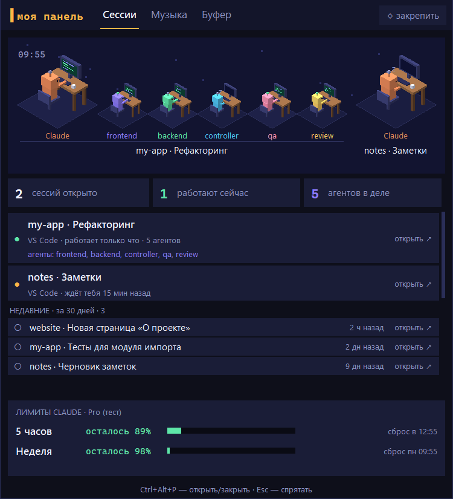

# Claude Panel — моя панель

Настольная панель для тех, кто работает с Claude Code. Прячется за верхним краем экрана и выезжает, если подвести курсор к середине верхнего края или нажать горячую клавишу.



## Что умеет

Вкладки: **Сессии · Музыка · Буфер · Загрузки · Сеть · Мониторы**.

Панель рассчитана на Windows и macOS. Модули вкладки «Сеть» (`netinfo.py`, `monitor.py`) поддерживают и Linux, но сама панель на Linux не заявлена.

**Управление панелью**

- Открыть/закрыть: курсор к середине верхнего края экрана или горячая клавиша — Windows `Ctrl+Alt+P`, Mac `⌘⌥P` (на Mac по умолчанию выключена, см. [Настройка](#настройка)). `Esc` — спрятать.
- Кнопка «закрепить» — панель не прячется, когда курсор уходит.
- Правый клик по заголовку «моя панель» — закрыть программу.

**Уведомления**

- «✓ Claude закончил» — сессия работала не меньше 10 секунд и освободилась. Для субагентов — «агент … закончил».
- «⚠ ждёт твоего разрешения» (или «ждёт твоего ответа») — сессия остановилась на запросе разрешения или вопросе. В офисе над агентом мигает красный «!», строка сессии в списке — красная.
- Панель сама выезжает на ~3 секунды с плашкой и звуком, **не забирая фокус** — можно продолжать печатать в другом окне. Клик по плашке открывает сессию, «✕» — закрывает плашку.
- Каждый вид уведомлений и звук отключаются в [настройках](#настройка) (`notify`).

**Вкладка «Сессии»**

- 3D-офис (изометрия): каждая живая сессия Claude Code — отдельная группа. Главный агент и его субагенты сидят за столами, у каждого подпись по типу агента (frontend, backend, controller…) и состояние «работает» / «ждёт».
- Список живых сессий в формате «проект · название вкладки».
- «Недавние» — прошлые сессии всех проектов за 30 дней.
- Клик по сессии открывает папку проекта в VS Code и саму сессию Claude (через `vscode://anthropic.claude-code/open?session=…`).
- Лимиты Claude, как в `/usage`: сколько процентов осталось на 5 часов и на неделю, когда сброс.

**Вкладка «Музыка»**

- Что играет: название, исполнитель, обложка или превью, прогресс, кнопки управления.
- Windows: любое приложение через системный медиа-центр. Для YouTube в браузере показывается живое видео прямо в панели.
- Mac: Spotify, Apple Music, YouTube в Chrome и Safari (через AppleScript). Живого видео нет, только обложка/превью.

**Вкладка «Буфер»**

- История копирования: текст и картинки. Хранится только в памяти, на диск не пишется. Картинок в истории — не больше 10.
- Кнопка «✂ Скриншот» — выделить область экрана мышью (`Esc` или правый клик — отмена). Снимок сразу попадает в буфер обмена и в историю. На Mac используется системное выделение области и нужно разрешение «Запись экрана» (Screen Recording).
- Пароли из менеджеров паролей в историю не попадают (по метке буфера и по активному окну):
  - метки «не сохранять», которые ставят KeePassXC, 1Password, Bitwarden и их браузерные расширения: на Windows — `ExcludeClipboardContentFromMonitorProcessing`, `Clipboard Viewer Ignore`, `CanIncludeInClipboardHistory=0`; на Mac (с `pyobjc-framework-Cocoa`) — `org.nspasteboard.ConcealedType`, `TransientType`, `AutoGeneratedType`;
  - копирование, пока активно окно менеджера паролей (KeePass/KeePassXC, Bitwarden, 1Password; на Mac также «Связка ключей» и «Пароли»).

**Вкладка «Загрузки»**

- Содержимое системной папки «Загрузки», новые сверху. На Windows берётся реальное расположение папки, даже если её перенесли (на другой диск, в OneDrive). На Mac — `~/Downloads`.
- Скрытые, системные и недокачанные файлы (`.crdownload`, `.part` и т. п.) не показываются. Список обновляется сам.
- Поиск по имени, кнопка «📂 Открыть папку».
- Выделение: клик — один файл, `Ctrl`+клик (Mac — `⌘`+клик) — добавить/убрать, `Shift`+клик — диапазон.
- Перетаскивание мышью одного или нескольких выделенных файлов в другие программы (Проводник/Finder, мессенджер, браузер, VS Code). Нужен пакет `tkinterdnd2`; на Mac — экспериментально.
- Двойной клик (или `Enter`) — открыть программой по умолчанию. Документы, картинки, аудио/видео, архивы и папки открываются сразу. Программы, скрипты, ярлыки, образы и неизвестные типы — только после подтверждения «Запустить программу …?».
- Правый клик: «Открыть», «Показать в папке», «Копировать путь» (для нескольких — «Копировать пути»).

**Вкладка «Сеть»**

Три блока сверху вниз: «Этот компьютер», «Проверка», «Серверы».

*Этот компьютер*

- Имя компьютера и основной IP (клик — скопировать).
- Внешний IP — только по кнопке: запрос к `api.ipify.org`, ответ кешируется на 10 минут.
- Шлюз, DNS, имя сети Wi-Fi (SSID), список активных интерфейсов с типом и IPv4. Адреса копируются кликом.

*Проверка*

- Поле адреса (имя хоста, IPv4, IPv6; вставленный URL сводится к имени хоста) и поле порта.
- Кнопки: **Ping** (4 пакета), **Trace** (до 20 хопов; хопы появляются по мере ответа, во время работы кнопка становится «■ Стоп»), **Порт** (TCP-подключение), **DNS** (адреса IPv4/IPv6 через системный резолвер).
- `Enter` в поле адреса запускает Ping, в поле порта — проверку порта. Одновременно идёт одна проверка.
- «Недавние» — последние 5 адресов, клик подставляет адрес. «⧉ копировать» — скопировать вывод.

*Серверы*

- Мониторинг серверов из `config.json` (до 12): ping раз в 30 секунд, кнопка «↻ обновить».
- Если указан `ssh` и настроен вход **по ключу** — раз в 2 минуты: диски (занято и свободно), память, загрузка (load average), состояние RAID (mdadm), uptime. Сервер должен быть на Linux.
- Пароль панель не спрашивает никогда: нет входа по ключу — показывается ошибка, а ping продолжает работать.
- Как добавить серверы — в разделе [Настройка](#настройка).

**Вкладка «Мониторы»**

Схема экранов «как на столе» и физически правильные переходы курсора между мониторами. Подробная спецификация — [docs/monitors-spec.md](docs/monitors-spec.md).

- **Мастер первого запуска.** Если в `config.json` нет секции `monitors`, вкладка открывается мастером: этот компьютер (имя для схемы), его экраны с размерами из EDID (для остальных — ввод диагонали), второй компьютер (если есть), расстановка экранов. «Готово — сохранить» записывает раскладку в `config.json`.
- **Схема в реальных миллиметрах.** Экраны перетаскиваются мышью, края притягиваются друг к другу (`Shift` — без привязки). С клавиатуры: `Tab` — к схеме, пробел — следующий экран, стрелки — сдвиг на 1 см (`Shift` — на 1 мм). Кнопка «Определить экраны» подтягивает подключённые мониторы.
- **Размер экрана**: диагональ в дюймах или см, либо ширина × высота в мм, либо кнопка «из EDID» (размер, который сообщает сам монитор).
- **Подсветка краёв**: зелёный — курсор выйдет **напротив**, жёлтый — **в ближайший угол** (пустая зона, где соседнего экрана нет), красный пунктир — **стена**. Если навести на край — видно, куда выйдет курсор.
- «Сохранить» — записать раскладку. «Копировать раскладку» / «Вставить раскладку» — перенести её на второй компьютер через буфер обмена.
- **«Применить к Windows»** — расставить экраны в настройках Windows по физической схеме. Раскладка ОС меняется **только по этой кнопке**. После применения появляется плашка «Раскладка Windows изменена. Оставить?». Если в течение 15 секунд не нажать «Оставить», прежняя раскладка возвращается. Если закрыть панель, пока плашка видна, раскладка тоже возвращается.
- **«Помощник курсора»** (только Windows, по умолчанию **выключен**). Поправляет переходы между мониторами **одного** компьютера по физическим размерам: курсор выходит напротив, а из пустой зоны — в ближайший угол. Работает по сохранённой раскладке.
  - Не ставит глобальных хуков ввода: курсор он только опрашивает и переставляет. Если панель зависнет или упадёт, мышь работает как обычно, просто без поправки.
  - Кнопка «Пауза» / «Продолжить» временно останавливает помощник, не выключая его (настройка в `config.json` не меняется).
  - Если переносов больше 10 в секунду, срабатывает аварийная пауза: помощник останавливается. Её снимает только выключение и повторное включение помощника, кнопка «Продолжить» не снимает.
  - «Дожим»: если курсор упёрся в край, через который Windows его не пускает, а мышь продолжают вести наружу, помощник переносит курсор на соседний экран. Без Raw Input помощник работает без дожима.
- **«Общая мышь» (Deskflow)** — одна мышь и клавиатура на два компьютера. Курсор переходит на другой компьютер через край по схеме, с учётом реальных размеров экранов.
  - Нужно на **обоих** компьютерах: [Deskflow 1.27+](https://github.com/deskflow/deskflow/releases) (`winget install --id Deskflow.Deskflow -e`), панель и `python -m pip install cryptography` (панель сама делает сертификат для защищённого соединения; без `cryptography` подойдёт `openssl`, например из Git for Windows).
  - Одинаковая раскладка на обоих: «Копировать раскладку» на одном, «Вставить раскладку» на другом.
  - На обоих нажмите «Общая мышь» и выберите один и тот же **главный** компьютер (к нему подключены мышь и клавиатура). Главный становится сервером Deskflow, второй — клиентом.
  - Первое подключение: появится плашка «… хочет подключиться». Сверьте показанный отпечаток со строкой «Отпечаток этого компьютера» на панели второго компьютера и нажмите «Совпадает — доверять». Это нужно сделать на обоих компьютерах.
  - `Ctrl+Alt+Shift+F11` — запереть курсор на текущем компьютере, `F12` — отпустить. `Ctrl+Alt+Shift+F9` / `F10` — перейти на первый / второй компьютер.
  - Input Director и другие подобные программы на время общей мыши закройте.
  - При закрытии панели Deskflow продолжает работать (`stop_on_exit: false`); при следующем запуске панель подхватывает его.
- Режим «Ноут как монитор» (Apollo/Moonlight) — в разработке, на вкладке он с пометкой «скоро».

## Требования

- Python 3.10 или новее, с tkinter:
  - Windows — установщик с [python.org](https://www.python.org/downloads/). При установке отметьте «Add python.exe to PATH».
  - Mac — с [python.org](https://www.python.org/downloads/) (tkinter уже внутри) или через Homebrew:
    ```bash
    brew install python python-tk
    ```
- [Claude Code](https://docs.anthropic.com/en/docs/claude-code), в который вы хотя бы раз вошли.
- [VS Code](https://code.visualstudio.com/) с расширением Claude Code (нужно, чтобы клик по сессии открывал её).
- Для серверов с ssh во вкладке «Сеть» — клиент OpenSSH (`ssh`). В Windows 10/11 и macOS он уже есть.

## Установка и запуск — Windows

1. Скачайте проект: `git clone` или кнопка **Code → Download ZIP** на GitHub (ZIP распакуйте).
   ```powershell
   git clone https://github.com/lannurl/claude-panel.git
   cd claude-panel
   ```
2. Установите зависимости:
   ```powershell
   python -m pip install -r requirements-windows.txt
   ```
   Ставятся Pillow, модули медиа-центра Windows и `tkinterdnd2`. `tkinterdnd2` необязателен: без него не работает только перетаскивание файлов из «Загрузок».
3. Запустите: двойной клик по `panel.pyw` или из консоли:
   ```powershell
   pythonw panel.pyw
   ```
   Окна консоли не будет — панель сразу спрятана у верхнего края.

**Автозапуск.** `Win+R` → `shell:startup` → Enter. В открывшуюся папку положите ярлык на `panel.pyw` (правый клик по файлу → «Создать ярлык», затем перенести ярлык).

## Установка и запуск — Mac

> Mac-версия экспериментальная: на реальном Mac она пока не тестировалась. Если что-то не работает — пожалуйста, откройте issue.

1. Скачайте проект:
   ```bash
   git clone https://github.com/lannurl/claude-panel.git
   cd claude-panel
   ```
2. Установите зависимости:
   ```bash
   python3 -m pip install -r requirements-mac.txt
   ```
   Обязателен только `pillow`. Остальное необязательно — если не ставится, панель работает и без него:
   - `pynput` — горячая клавиша `⌘⌥P`;
   - `pyobjc-framework-Cocoa` — несколько мониторов, точное отслеживание буфера и активного приложения, метки паролей в буфере;
   - `tkinterdnd2` — перетаскивание файлов из «Загрузок» (на Mac не проверено).
3. Запустите одним из способов:
   ```bash
   chmod +x run-mac.command   # один раз; дальше — двойной клик по run-mac.command в Finder
   ```
   или
   ```bash
   python3 panel.pyw
   ```
   `run-mac.command` берёт `.venv/bin/python3`, если в папке проекта есть виртуальное окружение `.venv`, иначе — системный `python3`. Если нет tkinter или Pillow, он напишет, что установить.

### Разрешения macOS

| Что | Где | Зачем |
|---|---|---|
| Accessibility | System Settings → Privacy & Security → Accessibility — добавить и включить Terminal (или Python, если запускаете им) | Горячая клавиша `⌘⌥P` (только если включена) |
| Automation | macOS сама спросит при первом обращении — нажать «Разрешить». Посмотреть потом: System Settings → Privacy & Security → Automation | Управление Spotify, Music, Google Chrome, Safari. System Events — только если не установлен `pyobjc-framework-Cocoa` |
| Chrome | View → Developer → Allow JavaScript from Apple Events | YouTube в Chrome |
| Safari | Settings → Advanced → Show Develop menu, затем Develop → Allow JavaScript from Apple Events | YouTube в Safari |
| Screen Recording («Запись экрана») | System Settings → Privacy & Security → Screen Recording | Скриншот области во вкладке «Буфер» и [самотест](#самотест) |

**Автозапуск.** System Settings → General → Login Items → «+» → выбрать `run-mac.command`.

## Настройка

Настройки необязательны: без `config.json` действуют значения по умолчанию. Чтобы их поменять, скопируйте пример рядом с `panel.pyw` и отредактируйте копию:

```bash
cp config.example.json config.json        # Mac
copy config.example.json config.json      # Windows
```

Во вкладке «Сеть», пока серверов нет, есть кнопка «Открыть config.json»: если файла нет, она создаст его из `config.example.json`.

| Поле | Тип | По умолчанию | Что делает |
|---|---|---|---|
| `main_agent_name` | строка, до 24 символов (длиннее — обрезается) | `"Claude"` | Подпись главного агента в 3D-офисе |
| `hotkey` | `true` / `false` | Windows — `true`, Mac — `false` | Включить глобальную горячую клавишу. Необязательное поле, в примере его нет |
| `notify.done` | `true` / `false` | `true` | Уведомление «Claude закончил» |
| `notify.permission` | `true` / `false` | `true` | Уведомление «ждёт разрешения / ответа» |
| `notify.sound` | `true` / `false` | `true` | Звук уведомлений |
| `servers` | список | `[]` | Серверы для блока «Серверы» во вкладке «Сеть», до 12 |
| `monitors` | объект | нет (тогда — мастер первого запуска) | Раскладка вкладки «Мониторы», см. ниже |

Поля сервера:

| Поле | Обязательно | Что это |
|---|---|---|
| `host` | да | Имя хоста, IPv4 или IPv6 — что пинговать |
| `name` | нет | Подпись в панели (до 32 символов), по умолчанию — `host` |
| `ssh` | нет | `пользователь@хост` для входа по ключу. Без него сервер только пингуется |
| `ssh_port` | нет | Порт ssh (1–65535), по умолчанию 22 |

Секция `monitors` (подробно — [docs/monitors-spec.md, §4](docs/monitors-spec.md)). Обычно её не правят руками: её записывают мастер и кнопка «Сохранить». Образец заполненной секции (ноут, монитор 27″ и второй ноут) — [docs/config-monitors.example.json](docs/config-monitors.example.json), формат `{"monitors": {...}}`. Чтобы взять его за основу, перенесите ключ `monitors` в свой `config.json`. При записи меняется только ключ `monitors`, остальные ключи `config.json` сохраняются; если файл не читается как JSON, он не перезаписывается.

| Поле | Что это |
|---|---|
| `version`, `revision` | Версия схемы (1) и номер сохранения (растёт при каждом «Сохранить») |
| `machines[]` | Компьютеры схемы (1–4): `id`, `name` (имя для Deskflow), `hostname` (по нему панель узнаёт «этот» компьютер), `host` (IP), `os` (`windows` / `macos` / `linux`) |
| `screens[]` | Экраны: `id` (`<машина>.<n>`), `machine`, `label`, `px` (разрешение), `scale` (масштаб Windows, только для подписи), `size_mm` (размер видимой области), `size_source` (`edid` / `user` / `default`), `pos_mm` (левый верхний угол на столе), `os_id`, `os_rect_px` |
| `edge_helper.enabled` | Помощник курсора, по умолчанию `false`. Удобнее включать кнопкой на вкладке |
| `edge_helper.poll_ms`, `push_mickeys`, `inset_px`, `max_step_px`, `skip_while_button_down` | Тонкая настройка помощника (по умолчанию 4, 4, 2, 600, `false`) |
| `deskflow` | «Общая мышь»: `port` (24800), `server` (id главного), `path` (путь к `deskflow-core`, если не найден сам), `tls`, `clipboard`, `work_on_hotkeys` |
| `startup_mode`, `stop_on_exit` | `last` — при запуске панели вернуть прошлый режим; `stop_on_exit: true` — останавливать Deskflow при выходе из панели |
| `stream`, `link` | Для режима «Ноут как монитор» и связки панелей — пока не используются |

Содержимое `config.example.json`:

```json
{
  "main_agent_name": "Claude",
  "notify": {"done": true, "permission": true, "sound": true},
  "servers": [
    {"name": "файл-сервер", "host": "192.0.2.10", "ssh": "admin@192.0.2.10", "ssh_port": 22},
    {"name": "роутер", "host": "192.0.2.1"}
  ]
}
```

Адреса `192.0.2.x` — документационные, замените на свои. Ненужные серверы удалите. Секции `monitors` в `config.example.json` нет, поэтому при первом открытии вкладки «Мониторы» запускается мастер.

**Горячая клавиша на Mac.** По умолчанию выключена: на новых macOS `pynput` может уронить процесс. Чтобы включить, добавьте `"hotkey": true`. Если после этого панель падает, верните `"hotkey": false`. Для работы нужны `pynput` и разрешение Accessibility.

**Вход на сервер по ключу.** Если ключа ещё нет — создайте его и положите публичную часть на сервер:

```bash
ssh-keygen -t ed25519                     # один раз, если нет ~/.ssh/id_ed25519
ssh-copy-id admin@192.0.2.10              # Mac / Linux
```

На Windows `ssh-copy-id` нет, то же самое в PowerShell:

```powershell
type $env:USERPROFILE\.ssh\id_ed25519.pub | ssh admin@192.0.2.10 "mkdir -p ~/.ssh && cat >> ~/.ssh/authorized_keys"
```

Проверка: `ssh admin@192.0.2.10` должен войти без пароля. Если ключ защищён паролем (passphrase), он должен быть загружен в ssh-agent — иначе панель не войдёт.

Неверные значения игнорируются (берутся значения по умолчанию; сервер с недопустимым `host`/`ssh`/`ssh_port` показывается с ошибкой и не опрашивается). После изменения перезапустите панель. `config.json` в git не попадает (он в `.gitignore`).

## Безопасность и приватность

**Что читается локально**

- `~/.claude` — список сессий и проектов Claude Code. Только чтение.
- Токен входа Claude Code (для лимитов):
  - Windows — `~/.claude/.credentials.json`;
  - Mac — Связка ключей, запись «Claude Code-credentials».
- Папка «Загрузки» — только список файлов верхнего уровня. Файлы открываются и запускаются только по вашему действию; программы и неизвестные типы — после подтверждения.

**Куда ходит сеть**

- `api.anthropic.com` — только запрос лимитов, тот же, что делает `/usage`. Токен отправляется только туда и больше никуда.
- Mac: загрузка обложек — только по HTTPS и только с `i.scdn.co`, `*.spotifycdn.com` (Spotify) и `i.ytimg.com` (YouTube), без перехода по редиректам.
- `api.ipify.org` — внешний IP, **только по кнопке** во вкладке «Сеть» (HTTPS, без редиректов, ответ кешируется на 10 минут).
- Серверы из `servers` в `config.json` — `ping` (если ICMP закрыт — TCP-подключение к порту ssh) и `ssh`.
- Блок «Проверка» — только по вашему действию, к адресу, который вы ввели: ping, traceroute, TCP-подключение, DNS-запрос.
- Других сетевых запросов нет.

**Сетевые проверки («Проверка», «Этот компьютер»)**

- Адрес проверяется строго (имя хоста, IPv4, IPv6; значения с `-` в начале и спецсимволы отклоняются).
- Утилиты (`ping`, `tracert` на Windows, `traceroute`/`tracepath` на macOS и Linux, а также системные команды для сведений о сети) запускаются без командной оболочки, аргументы передаются списком, системные утилиты — по абсолютному пути.
- MAC-адреса и SSID в лог не пишутся.

**Мониторинг серверов**

- Запускаются только `ping` и `ssh`. Значения `host` и `ssh` проходят строгую проверку (имя хоста, IPv4, IPv6, `пользователь@хост`; значения, начинающиеся с `-`, отклоняются) и передаются списком аргументов, без командной оболочки.
- `ssh` работает в `BatchMode=yes`, вход по паролю отключён: пароль не запрашивается никогда.
- На сервере выполняются только чтения: `df`, `free`, `/proc/loadavg`, `/proc/mdstat`, `uptime`.
- Ключ хоста при первом подключении запоминается автоматически (`StrictHostKeyChecking=accept-new`); если он потом изменится, панель не подключится и покажет ошибку.

**Мониторы**

- Раскладка экранов в настройках ОС меняется **только по кнопке** «Применить к Windows» и **только с подтверждением**: без «Оставить» через 15 секунд (или при закрытии панели) возвращается прежняя.
- Помощник курсора по умолчанию выключен и не ставит глобальных хуков ввода (никакого `WH_MOUSE_LL`). Он только опрашивает позицию курсора и переставляет его, поэтому мышь не зависит от панели. При частых переносах (больше 10 в секунду) помощник сам встаёт на аварийную паузу.
- Размер экрана из EDID читается из реестра без прав администратора. Права панель не повышает.
- «Общая мышь»: Deskflow слушает только LAN-адрес главного компьютера (не `0.0.0.0`), соединение — TLS с взаимной проверкой отпечатков; незнакомый компьютер не подключится, пока вы не подтвердите его отпечаток. Доверенные отпечатки — `C:\ProgramData\Deskflow\tls\trusted-*`, сертификат — в папке данных панели. Чужие процессы Deskflow (его GUI, служба) панель не трогает.
- Служебное состояние вкладки хранится вне папки проекта: Windows — `%LOCALAPPDATA%\MyPanel\monitors`, Mac — папка поддержки панели.

**Буфер обмена** хранится только в памяти (включая картинки и скриншоты) и пропадает при закрытии панели. Копирование из менеджеров паролей игнорируется.

## Ограничения и известные особенности

**Windows**

- Живое видео YouTube показывается, только если окно браузера не свёрнуто и YouTube открыт на активной вкладке. Иначе показывается обложка.

**Mac**

- Экспериментальная версия, на реальном Mac не тестировалась — сообщайте о проблемах.
- Живого видео нет, только обложка/превью.
- YouTube распознаётся только на активной вкладке переднего окна Chrome/Safari.
- Кнопка «назад» на YouTube перематывает видео в начало.
- Без `pyobjc-framework-Cocoa` панель работает только на основном экране.
- Перетаскивание файлов из «Загрузок» не проверено.
- Скриншот области требует разрешения «Запись экрана».

**Сеть**

- Подробные данные о сервере (диски, память, RAID) — только для Linux-серверов и только при входе по ключу.
- Сведения о сети собираются по-разному на каждой ОС: Windows — WinAPI (`GetAdaptersAddresses`, SSID — `netsh wlan`), macOS — `ifconfig`, `route`, `scutil`, `networksetup`, Linux — `ip -j`, `resolvectl`/`resolv.conf`, `iwgetid`/`nmcli`. Trace на Linux требует `traceroute` или `tracepath`.

**Мониторы**

- «Общая мышь» проверена на Windows; на macOS не проверялась. Режим «Ноут как монитор» (Apollo/Moonlight) — в разработке.
- Помощник курсора пока только для Windows.
- Mac и Linux — позже. На Mac схема и список экранов частично готовы, но не проверены, помощника нет. Linux не поддерживается.

**Лимиты**

- Если запрашивать слишком часто, сервер отвечает 429. Панель покажет «слишком часто, повтор через N мин» и сама подождёт.

## Самотест

Открывает панель на выбранной вкладке, примерно через 6 секунд сохраняет её снимок в PNG и закрывается. API лимитов не вызывается — лимиты подставные. С `--demo` вместо реальных данных показываются демонстрационные. Работает, даже если панель уже запущена.

```bash
python panel.pyw --test sessions out.png    # вкладка: sessions | music | clip | downloads | net | monitors | notify
python panel.pyw --test net out.png --demo
python panel.pyw --test monitors out.png --demo
```

`monitors` с `--demo` работает на подменённом контроллере: ничего не пишет и раскладку Windows не трогает. Кроме основного снимка сохраняет `out_on.png` (помощник включён) и `out_wizard.png` (мастер первого запуска).

Модульные тесты (stdlib `unittest`, запускать из папки проекта):

```bash
python -m unittest discover -s tests
```

`notify` — плашки уведомлений поверх спрятанной панели. `net` без `--demo` пингует только `127.0.0.1` и внешний IP не запрашивает. С `--demo` данные подменены, дополнительно запускается Trace и сохраняется второй снимок `out_trace.png`. Старое имя `server` по-прежнему работает и открывает вкладку «Сеть». На Mac — `python3` и разрешение Screen Recording.

## Решение проблем

| Проблема | Что сделать |
|---|---|
| Панель не выезжает | Возможно, уже запущен второй экземпляр (новый тогда сразу закрывается). Закройте панель (правый клик по заголовку) или завершите процесс `pythonw` / `python3` и запустите заново. |
| «Ctrl+Alt+P занят другой программой» | Сочетание занято другим приложением. Открывайте панель курсором к верхнему краю или освободите сочетание. |
| Mac: «⌘⌥P недоступна» или клавиша не реагирует | Проверьте, что в `config.json` стоит `"hotkey": true`, установлен `pynput` и выдано разрешение Accessibility. Затем перезапустите панель. |
| Mac: панель падает после включения горячей клавиши | Поставьте `"hotkey": false` в `config.json`. |
| Музыка: «Сейчас ничего не играет» | Включите воспроизведение. На Mac проверьте разрешение Automation для плеера, а для браузера — «Allow JavaScript from Apple Events» и что YouTube на активной вкладке переднего окна. |
| Лимиты: «войди в Claude Code» | Токен не найден. Войдите в Claude Code (`/login`). На Mac проверьте, что в Связке ключей есть запись «Claude Code-credentials». |
| Лимиты: «войди в Claude Code заново» | Токен устарел. Выйдите и снова войдите в Claude Code (`/login`). |
| Файлы из «Загрузок» не перетаскиваются | Установите `tkinterdnd2` (`python -m pip install tkinterdnd2`, на Mac — `python3 -m pip ...`) и перезапустите панель. |
| Нет вкладки «Загрузки» или «Сеть» | Рядом с `panel.pyw` не хватает `downloads.py` или `netinfo.py`/`monitor.py` — скачайте проект целиком. |
| Сеть: внешний IP «не удалось получить» | Нет интернета или `api.ipify.org` недоступен (фаервол, прокси). Попробуйте позже. |
| Сеть: Trace не работает на Linux | Установите `traceroute` или `tracepath` (пакет `iputils-tracepath`). |
| Сервер: «нет доступа по ключу (Permission denied)» | Ключ не установлен на сервер: `ssh-copy-id пользователь@хост` (Windows — команда из раздела [Настройка](#настройка)). Проверьте, что `ssh пользователь@хост` входит без пароля. |
| Сервер: «ключ хоста изменился — проверьте known_hosts» | Если сервер действительно переустановлен: `ssh-keygen -R хост`, затем один раз `ssh пользователь@хост` вручную. Если нет — разберитесь, почему сменился ключ. |
| Сервер: «ssh не найден (нужен OpenSSH-клиент)» | Windows: Параметры → Система → Дополнительные компоненты → «Клиент OpenSSH». |
| Мониторы: «Модуль не найден» | Рядом с `panel.pyw` не хватает `layout.py` или `monitors_ctl.py` — скачайте проект целиком. |
| Общая мышь: «Deskflow не установлен» | Поставьте Deskflow (команда есть на вкладке, кнопка «Копировать команду») и откройте вкладку заново. |
| Общая мышь: «конфликт» | Запущен Deskflow GUI или другая копия — остановите в нём сервер/клиент или закройте его. |
| Общая мышь: второй компьютер не подключается | Проверьте, что раскладки одинаковые и главный выбран один и тот же; что отпечатки подтверждены на обоих; что брандмауэр Windows пускает Deskflow (порт 24800) в частной сети. |
| Общая мышь: нет прав записать доверенный отпечаток | Панель покажет строку — добавьте её в указанный файл от имени администратора. |
| Мониторы: после «Применить к Windows» экраны встали не так | Не нажимайте «Оставить» — через 15 секунд вернётся прежняя раскладка. |
| Мониторы: «Аварийная пауза: слишком много переносов курсора подряд» | Помощник сам остановился. Выключите и снова включите его («Продолжить» эту паузу не снимает). Если повторяется, проверьте схему (не перекрываются ли экраны) и сохраните раскладку. |
| Мониторы: помощник «включён, но не запущен» | Раскладка не сохранена или в ней ошибки — смотрите предупреждения над кнопками, нажмите «Сохранить». |
| Скриншот на Mac пустой или не делается | Выдайте разрешение «Запись экрана» Terminal/Python и перезапустите панель. |

## Лицензия

[MIT](LICENSE).
